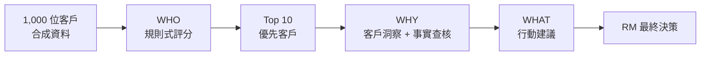
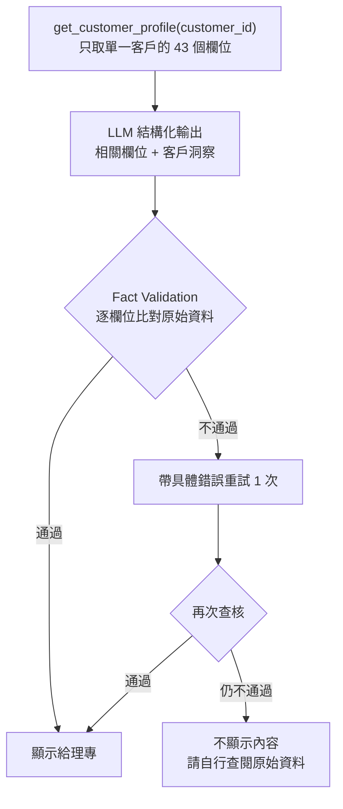

# 財富管理客戶經營決策支援 AI Assistant

> 從「提供資訊」到「提供決策支援」：協助理專（RM）在打電話前回答三個問題：
> **今天先聯繫誰（WHO）？為什麼（WHY）？聯繫時可以談什麼（WHAT）？**
>
> Decision Support POC ｜ 合成資料 ｜ Python ｜ LLM + Function Calling + RAG ｜ 使用 Claude Code 分階段開發

| 階段 | 任務 | 核心技術 | 狀態 |
|---|---|---|---|
| WHO | 優先聯繫客戶排序 | Rule-based Scoring | 已完成 |
| WHY | 客戶洞察與事實查核 | Function Calling + LLM 結構化輸出 + Fact Validation | 已完成 |
| WHAT | 下一步行動建議 | Product RAG + LLM | 已完成 |
| Agent Flow | 多流程協調 | Function Calling / Agent Workflow | 已完成 |

**重要聲明：** 本專案使用**合成資料**做概念驗證，不含真實客戶資料；不宣稱任何真實業務成效。

---

## 問題背景

財富管理單位理專打 Outbound Call 前，要在 CRM、財管系統之間切換查資料，數據團隊建立了整合多來源資料的 **Customer 360 Dashboard**。

Dashboard 成效：所有理專都有使用儀表板，9 成人員認為有助於產生客戶洞察。但重新檢視使用流程後，發現還有兩個缺口：

1. **資料已整合，但仍需人工判斷**：理專要自己看資料、找訊號、解讀，才能決定先聯繫誰、聊什麼。
2. **既有推薦邏輯是業務假設**：例如「基金瀏覽 + 申購未完成 = 可能有興趣」，但從未驗證實際成功率。

因此本專案要解決的不是資料取得，而是**資料取得之後的判斷成本**。

## 解法：WHO → WHY → WHAT



- 設計原則：確定性交給程式，語意理解才交給 LLM
- 本專案是 **Decision Support**，不是自主理財顧問，不自動聯繫客戶、不自動交易。

| 元件 | 負責 | 不負責 |
|---|---|---|
| Python | 特徵工程、Priority Score、排序、行動選擇、事實查核、推薦驗證 | — |
| LLM | 從客戶資料挑選相關欄位、撰寫洞察、把產品資訊說明成自然語言 | 不重算分數、不新增規則、不決定適合度、不編造事實 |
| RAG | 檢索產品知識（Metadata 過濾 + Content 說明） | 不檢索客戶個資、不決定行動 |
| RM（理專） | 最終決策與客戶聯繫 | — |

---

## 產品設計三階段

### WHO：優先聯繫客戶排序

在 1,000 位客戶中找出今天最值得優先聯繫的 Top 10。

```
Priority Score = Investment Gap × 45% + Investment Intent × 35% + Asset Potential × 20%
```

| 子分數 | 訊號 | 組成特徵與權重 |
|---|---|---|
| Investment Gap 投資缺口 | 有閒置資金與配置缺口 | 台幣活存占比 40%、AUM 30%、投資占比 20%、是否持有基金 10% |
| Investment Intent 投資意圖 | 近期有投資行為跡象 | 近 1 月轉入金額 40%、未完成基金申購 35%、近 1 月基金瀏覽次數 25% |
| Asset Potential 資產潛力 | 客戶資產規模 | AUM 70%、職業 15%、職稱 15% |

- **為什麼不用 LLM 或 ML 排序？** 排序需要穩定、可重現、可解釋、可測試；目前也沒有真實轉換標籤可供訓練。規則式評分作為透明的 Baseline，未來有標記資料再與 ML 比較。
- **注意：** 各項權重是業務假設，尚未經真實成效驗證。

### WHY：客戶洞察與事實查核

回答「為什麼這位客戶值得優先聯繫？」重點是**LLM 輸出必須可追溯到原始資料**。



- **Function Calling 取單筆資料**：不把整份 CSV 丟給 LLM，降低 Token 與延遲、避免無關資料干擾、控制資料存取範圍。
- **五種查核類型**：（欄位不存在）`customer_id_mismatch`、`unknown_field`、`value_mismatch`（數值不符）、`priority_score_mismatch`、`priority_rank_mismatch`。
- **輸出層與查核層分離**：`CustomerInsight`（LLM 輸出，可能有誤）與 `FactCheckResult`（程式比對結果）是兩個獨立的 Pydantic model，查核邏輯不需呼叫 LLM 就能單獨測試。
- **寧可空白，也不顯示未經驗證的內容。**

輸出範例（節錄）：

```json
{
  "customer_id": "C0001",
  "key_fields": [
    { "field": "total_aum", "value": 8000000 },
    { "field": "twd_demand_ratio", "value": 0.72 },
    { "field": "investment_ratio", "value": 0.08 },
    { "field": "has_fund", "value": 0 },
    { "field": "fund_view_count_1m", "value": 18 }
  ],
  "insight": "客戶目前資產約800萬元，台幣活存占AUM約72%，理財庫存占比僅8%，目前沒有基金持有；近1個月有18次基金瀏覽，因此可優先了解其投資需求。"
}
```

### WHAT：下一步行動建議

根據客戶條件與產品知識，從**預先定義的行動**中提出建議，由理專最終判斷。

| 行動 | 名稱 | 成立條件（節錄） |
|---|---|---|
| A1 | 投資需求訪談 | 投資意圖分數 ≥ 50 且投資占比 < 30% |
| A2 | 基金產品介紹 | 未持有基金、投資意圖分數 ≥ 70、風險屬性為 Medium / High |
| A3 | 定存資產配置討論 | 持有台幣或外幣定存 |
| A4 | 外幣資產配置討論 | 持有外幣活存或外幣定存 |
| A5 | 既有投資組合檢視 | 有理財庫存且投資占比 ≥ 30% |
| A6 | 暫不聯繫 | 不符合 A1–A5 任一條件 |

- **規則判斷層是純 Python**：逐條計算 A1–A6 是否成立，再依固定優先順序 `A2 > A3 > A4 > A5 > A1 > A6` 選出唯一行動。LLM 不能覆蓋這個結果，只能決定說明怎麼寫。
- **Product RAG 只在行動為 A2 / A3 / A4 時觸發**，知識庫包含基金、定存、外幣與 FAQ；Metadata（風險屬性、幣別、生效日期等）用於過濾與追溯，Content（產品特色、適用客群、注意事項）用於說明。
- **Recommendation Validation**：驗證推薦的行動與規則結果一致，且推薦的產品確實存在於檢索到的產品知識，內容未被竄改。

---

## 評估

| 階段 | 評估方式 | 
|---|---|
| WHO | Business Logic Validation| 
| WHY | Decision Time、Factual Accuracy、Hallucination Rate | 
| WHAT | Action Acceptance、Recommendation Accuracy | 

**實驗設計（尚未執行）：** 理專 + Customer 360 Dashboard vs. 理專 + AI Assistant，比較決策時間與行動接受度。

---

## 專案結構

```
# 以實際 repo 的目錄為準
wealth-rm-agent/
├── CLAUDE.md                 # 開發規則與階段定義（供 Claude Code 使用）
├── README.md
├── pyproject.toml            # Poetry
├── docs/
│   ├── project_definition.md
│   ├── ai_product_design.md
│   ├── evaluation_design.md
│   ├── experiment_design.md
│   └── ai_product_data_definition.xlsx   # 資料規格（欄位、評分權重的依據）
├── data/synthetic/           # 合成客戶資料（raw / features / scored）
├── src/
│   ├── ranking/              # WHO：資料生成、特徵工程、評分、排序
│   ├── insight/              # WHY：insight_generator、fact_validator
│   ├── tools/                # Function Calling：customer_tool
│   ├── rag/                  # WHAT：產品知識檢索
│   ├── agent/                # Agent：rm_agent、agent_llm、agent_tools、render
│   ├── ui/                   # UI：app（Streamlit）、view_models
│   └── evaluation/           # 評估
├── outputs/                  # 客戶排序結果（all / top10）
└── tests/                    # pytest
```

## 執行方式

```
poetry install
cp .env.example .env          # 填入 GEMINI_API_KEY；模型名稱在 GEMINI_MODEL
poetry run streamlit run src/ui/app.py       # 網頁介面
poetry run python src/agent/rm_agent.py      # 命令列對話
poetry run pytest                            # 測試
```

免費額度：Gemini 免費層每個模型有每日請求上限，遇到 429 時把 `.env` 的 `GEMINI_MODEL` 換成別的模型即可。

## 開發方式

本專案使用 Claude Code 開發，但以文件主導：

- 用 `CLAUDE.md` 與 `docs/` 明確定義專案架構、開發階段與協作規則。
- 每個步驟先提出規劃與假設，人工確認後才實作；不跳階段，不一次做完整個專案。
- 完成後補上 pytest 自動化測試並回報結果。
- 資料規格定義、查核失敗處理方式等關鍵決策由人工判斷確認。

## Roadmap

| Phase | 內容 | 狀態 |
|---|---|---|
| 1 | WHO：資料生成、特徵、評分、排序 | 已完成 |
| 2 | WHY：客戶資料 Tool、洞察生成、事實查核、評估 | 已完成 |
| 3 | WHAT：行動規則、產品知識庫、RAG、推薦驗證 | 已完成 |
| 4 | Agent / Tool Use：Tool schema、Agent workflow、Guardrails | 已完成 |
| 5 | UI 介面 | 已完成 |
| 6 | 實驗與優化：延遲分析、檢索與 Prompt / 模型實驗、RM 回饋 | 規劃中 |

## 限制與聲明

- 合成資料：1,000 筆模擬客戶，一次性資料不會自動更新，結果反映產品設計，不代表真實客戶表現。
- 權重與門檻是業務假設：Priority Score 權重、行動規則門檻都尚未經真實成效驗證。
- 產品知識庫規模小：POC 階段的產品資料量有限，檢索評估的代表性有限。
- 本專案為概念驗證，不可直接用於真實客戶或金融決策。

## 文件

- [商業背景與問題發現](docs/project_definition.md)
- [AI 產品設計](docs/ai_product_design.md)
- [評估設計（Evaluation Design）](docs/evaluation_design.md)

## 授權

版權所有 2025 Hailey Hsiao， 作者保有所有權利。
dwarfxiao@gmail.com
